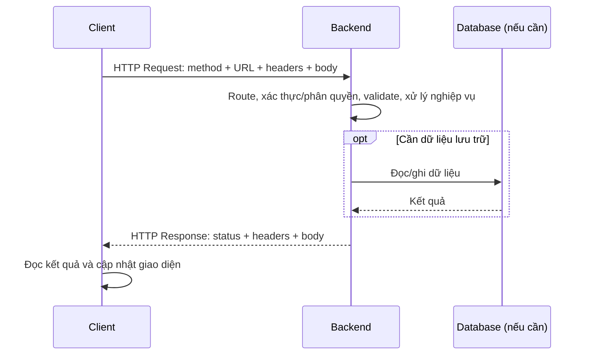

# HTTP + REST Practice cho Java Backend

Workspace học cơ chế HTTP, API và cách thiết kế hợp đồng API. Java thuần ở phần lab,
không Spring Boot, không JPA/Hibernate và không dependency bên ngoài.
Đọc kiến thức → dự đoán request/response → chạy thử → giải thích → tự thiết kế API.

## Luồng xuyên suốt

Database không phải thành phần bắt buộc của mỗi HTTP request. Lab dùng dữ liệu demo cố định
trong bộ nhớ; các mini design sẽ yêu cầu bạn suy nghĩ về dữ liệu users/products/orders.

## Mỗi chủ đề có gì?
- `README.md`: vấn đề, vị trí trong luồng, kiến thức cần hiểu, ví dụ request/response,
  lỗi thường gặp, 3–5 câu tự kiểm tra và ba bài tăng dần độ khó.
- `exercises.md`: đề bài và TODO, chỗ để bạn tự giải thích; không chứa lời giải.
- `demo.http`: request mẫu gửi được tới lab, có hướng dẫn dự đoán trước khi chạy.
- `solutions/<chủ-đề>.md`: đáp án tham khảo riêng. Chỉ mở sau khi tự thử.

Các bộ thiết kế có `requests.http` chỉ chứa TODO để bạn tự viết route/header/body.
Mini design chỉ cung cấp nghiệp vụ và khung; solution mini là rubric/gợi ý, không có toàn bộ endpoint đã giải.

## Bắt đầu và thứ tự học
| Thứ tự | Chủ đề |
|---:|---|
| 01 | [Web basics](01-web-basics/README.md): client, server, DNS, kết nối |
| 02 | [Request/response](02-http-request-response/README.md): cấu trúc message |
| 03 | [HTTP methods](03-http-methods/README.md): ý nghĩa method |
| 04 | [URL/path/query](04-url-path-query/README.md): định danh và tùy chọn truy vấn |
| 05 | [Headers](05-http-headers/README.md): metadata và negotiation |
| 06 | [Body/JSON](06-request-body-json/README.md): dữ liệu và biểu diễn |
| 07 | [Status codes](07-status-codes/README.md): kết quả giao tiếp |
| 08 | [API basics](08-api-basics/README.md): hợp đồng client/backend |
| 09 | [REST basics](09-rest-basics/README.md): resource và các ràng buộc |
| 10 | [RESTful design](10-restful-design/README.md): mô hình hóa nghiệp vụ |
| 11 | [Stateless/idempotent](11-stateless-idempotent/README.md): request độc lập và retry |
| 12 | [Authentication/authorization](12-authentication-authorization/README.md): danh tính và quyền |
| 13 | [Cookie/session/JWT](13-cookie-session-jwt/README.md): mang và quản lý thông tin xác thực |
| 14 | [CORS/HTTPS](14-cors-https/README.md): browser origin và TLS |

Sau bài 07 làm [predict-request-response](exercises/predict-request-response/README.md)
và [postman-practice](exercises/postman-practice/README.md). Sau bài 10 làm
[design-api](exercises/design-api/README.md) và [fix-bad-api](exercises/fix-bad-api/README.md).
Sau bài 14 tự thiết kế [user](mini-api-designs/user-management/README.md),
[product](mini-api-designs/product-management/README.md),
[order](mini-api-designs/order-management/README.md).

Để ôn lại, dùng [study-log.md](study-log.md), [self-check.md](self-check.md) và
[api-contract-template.md](api-contract-template.md). Ghi câu trả lời trước khi xem solutions.

## Gửi request thật bằng Java thuần
Cần JDK 17+ trong PATH. Mở terminal ở thư mục workspace:
```powershell
cd E:\JAVA_FULL\http-rest-practice
powershell -NoProfile -ExecutionPolicy Bypass -File .\lab-server\start.ps1
```
Giữ terminal này mở. Server chạy tại `http://localhost:8080`, bind loopback `127.0.0.1`.
Dừng bằng Ctrl+C. Nếu port đang được dùng:
```powershell
powershell -NoProfile -ExecutionPolicy Bypass -File .\lab-server\start.ps1 -Port 8081
```
Sau đó đổi `@baseUrl` trong file `.http`, hoặc biến `baseUrl` trong Postman, sang port mới.

Mở terminal thứ hai để thử:
```powershell
curl.exe -i http://localhost:8080/health
curl.exe -i http://localhost:8080/products/10
curl.exe -i http://localhost:8080/status/404
```
Hoặc mở `demo.http` bằng HTTP client của IDE nếu có. Chọn từng request và gửi riêng.
Trong Postman tạo environment `baseUrl=http://localhost:8080`; cú pháp URL là
`{{baseUrl}}/health`. File `.http` dùng `@baseUrl` và `{{baseUrl}}` theo client IDE.
Không yêu cầu cài IDE extension để học: curl và Postman đều dùng được.

## Phạm vi lab và phạm vi bài thiết kế
Lab hỗ trợ `/health`, `/echo`, `/products`, `/products/10`, `/status/{code}` và `/cors`.
Xem [lab-server/README.md](lab-server/README.md) để biết từng contract.
`/echo` trả body đầu vào **dưới dạng string**, không parse/validate JSON, không lưu dữ liệu,
không xác thực Bearer/JWT/cookie. `/status/{code}` trả status mẫu, không thực hiện nghiệp vụ tương ứng.
Catalog demo không triển khai search/filter/pagination; dùng `/echo?...` để quan sát raw query.

Các request CRUD users/products/orders và hủy order là **bài thiết kế hợp đồng**.
Sau khi tự viết vào templates, hãy đối chiếu bằng rubric; lab hiện chưa chạy những hợp đồng đó.
Ví dụ HTTP trong README là minh họa HTTP/1.1 và có thể lược các header do server tự thêm.
HTTP/2 và HTTP/3 có cách biểu diễn message trên đường truyền khác.

Lab dùng HTTP local. Phần HTTPS giải thích TLS và phân tích tình huống, không tạo chứng chỉ/server TLS.
CORS cần browser để quan sát việc JavaScript được phép đọc response; Postman/curl chỉ giúp xem headers.
Workspace có trang quan sát CORS cùng server JDK ở port 3000:
```powershell
powershell -NoProfile -ExecutionPolicy Bypass -File .\lab-server\start-client.ps1
```
Chạy trong terminal thứ hai khi backend lab còn mở, rồi truy cập `http://localhost:3000`.

## Khi nào chuyển sang Java Backend/JDBC?
Sau khi tự thiết kế được request/response, status, validation, quyền truy cập và retry,
bạn có thể hiện thực contract bằng Java và kết nối [workspace SQL](../sql-postgresql-practice/README.md)
qua JDBC. Trước đó không cần framework để học các khái niệm này.

## Tài liệu gốc và cây thư mục
Xem [STRUCTURE.md](STRUCTURE.md) để có cây đầy đủ và [solutions/README.md](solutions/README.md)
để dùng đáp án tham khảo đúng lúc.
Các nguồn chính để kiểm chứng kiến thức:
[HTTP semantics — RFC 9110](https://www.rfc-editor.org/rfc/rfc9110.html),
[PATCH — RFC 5789](https://www.rfc-editor.org/rfc/rfc5789.html),
[REST — Fielding](https://ics.uci.edu/~fielding/pubs/dissertation/rest_arch_style.htm),
[CORS — Fetch Standard](https://fetch.spec.whatwg.org/#http-cors-protocol),
[JWT — RFC 8725](https://www.rfc-editor.org/rfc/rfc8725.html).
