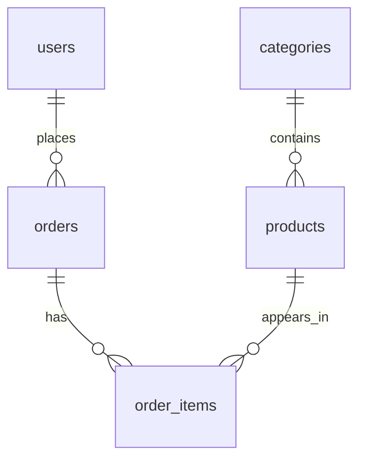

# Database mini e-commerce

Database duy nhất: `sql_postgresql_practice`, schema `public`.
Trong pgAdmin/psql, kết nối đúng database rồi chạy `schema.sql`, tiếp theo `seed.sql`.
`create_database.sql` chạy khi đang kết nối `postgres`, chỉ một lần, ngoài transaction.
`reset.sql` xóa dữ liệu năm bảng và reset identity; sau đó chạy lại `seed.sql`.

## Mô hình và ý nghĩa

User có thể chưa có order; category có thể chưa có product. FK từ phía con là NOT NULL.
Một order có nhiều order_items theo nghiệp vụ, nhưng FK tự nó không bắt buộc order có dòng hàng.
Một product có thể xuất hiện trong nhiều order. Quan hệ orders–products nhiều-nhiều qua order_items.
Unique `(order_id, product_id)` yêu cầu gộp số lượng cùng sản phẩm trong một đơn.

## Quy ước dữ liệu
- Tiền VND lưu `NUMERIC(14,2)`, dùng `BigDecimal` khi học JDBC; tránh double cho tiền.
- `products.price` là giá hiện tại; `order_items.price` là đơn giá tại thời điểm mua.
- `orders.total` phải bằng tổng quantity × item.price. Schema không có trigger nên transaction/service phải giữ quy tắc này.
- `created_at` là TIMESTAMPTZ; timestamp seed có offset +07. Dùng khoảng thời gian nửa mở khi lọc tháng.
- Báo cáo doanh thu trong bài học chỉ tính `paid` và `shipped`; `pending` và `cancelled` không tính.
- Email seed đã trim/lowercase, UNIQUE theo giá trị đã chuẩn hóa. CHECK chỉ kiểm tra cơ bản, không validate email đầy đủ.
- Xóa user/category/product đang được tham chiếu bị RESTRICT; xóa order sẽ CASCADE các order_items.
- Sequence có thể có khoảng trống sau ROLLBACK; ID không phải số thứ tự nghiệp vụ liên tục.

## Dữ liệu cố định
| Bảng | Số dòng |
|---|---:|
| users | 12 |
| categories | 5 |
| products | 25 |
| orders | 24 |
| order_items | 48 |

Users 11,12 chưa có order. Products 21–25 chưa xuất hiện trong order_items.
Products 5,10,20,25 hết hàng. Danh mục: robot, laptop, phone, accessories, books.
Users tạo tháng 12/2025. Orders 1–10 tháng 01/2026, 11–20 tháng 02, 21–24 tháng 03.
Một số giá lúc mua khác giá hiện tại để luyện tính doanh thu đúng.
Stock là ảnh chụp số tồn hiện tại, không suy ngược từ orders seed; đơn bị hủy vẫn giữ dòng hàng để luyện lọc trạng thái.

## Kiểm tra sau seed
```sql
SELECT 'users' AS table_name, COUNT(*) AS rows FROM users
UNION ALL SELECT 'categories', COUNT(*) FROM categories
UNION ALL SELECT 'products', COUNT(*) FROM products
UNION ALL SELECT 'orders', COUNT(*) FROM orders
UNION ALL SELECT 'order_items', COUNT(*) FROM order_items;
```

## Lỗi thường gặp
Chạy schema trên database `postgres`; seed hai lần; bỏ qua lỗi rồi nghĩ script chạy đủ;
thay seed price mà không cập nhật total; truyền ID thủ công mà quên đồng bộ sequence.

## Tự kiểm tra
1. FK có tự bảo đảm orders.total bằng tổng dòng hàng không?
2. Vì sao item.price phải lưu riêng với giá sản phẩm hiện tại?
3. Vì sao DELETE order ảnh hưởng order_items nhưng không xóa product?
4. Vì sao user chưa mua hàng không phải dữ liệu sai?
